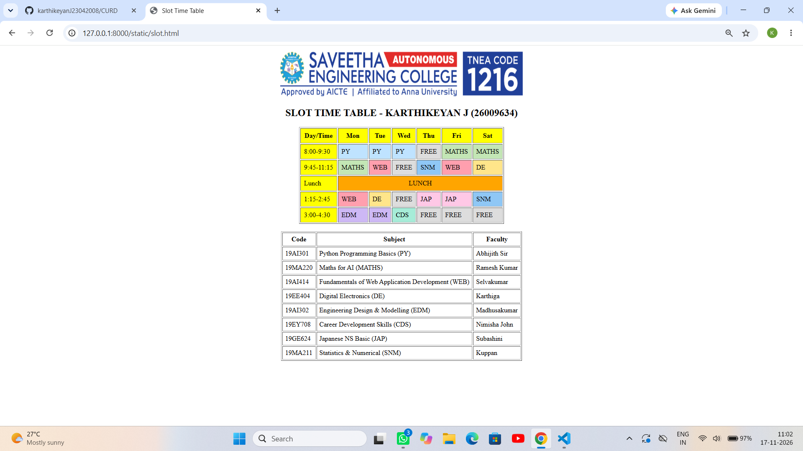

# Ex02 Time Table
## Date:
17/11/2026
## AIM
To write a html webpage page to display your slot timetable.

## ALGORITHM
### STEP 1
Create a Django-admin Interface.

### STEP 2
Create an App inside the Django project.

### STEP 2
Create a static folder uder the created App and insert HTML code.

### STEP 3
Create a simple table using ```<table>``` tag in html with the relevant attributes.

### STEP 4
Add rows using ```<tr>``` tag.

### STEP 5
Add your course schedule using ```<td>``` tag.

### STEP 6
Execute the program using runserver command.

## PROGRAM
```
<html>
<head>
<title>Slot Time Table</title>
</head>
<body>
<center>

<h2 align="center">SLOT TIME TABLE - KARTHIKEYAN J (26009634)</h2>

<table border="1" cellpadding="8" align="center">
<tr bgcolor="yellow">
  <th>Day/Time</th><th>Mon</th><th>Tue</th><th>Wed</th><th>Thu</th><th>Fri</th><th>Sat</th>
</tr>
<tr>
  <td bgcolor="yellow">8:00-9:30</td>
  <td bgcolor="#bfe3ff">PY</td><td bgcolor="#bfe3ff">PY</td><td bgcolor="#bfe3ff">PY</td>
  <td bgcolor="#ddd">FREE</td>
  <td bgcolor="#c3e6b5">MATHS</td><td bgcolor="#c3e6b5">MATHS</td>
</tr>
<tr>
  <td bgcolor="yellow">9:45-11:15</td>
  <td bgcolor="#c3e6b5">MATHS</td><td bgcolor="#ff9fae">WEB</td>
  <td bgcolor="#ddd">FREE</td>
  <td bgcolor="#8fc7f5">SNM</td><td bgcolor="#ff9fae">WEB</td>
  <td bgcolor="#ffe58a">DE</td>
</tr>
<tr>
  <td bgcolor="yellow">Lunch</td>
  <td colspan="6" align="center" bgcolor="orange">LUNCH</td>
</tr>
<tr>
  <td bgcolor="yellow">1:15-2:45</td>
  <td bgcolor="#ff9fae">WEB</td><td bgcolor="#ffe58a">DE</td>
  <td bgcolor="#ddd">FREE</td>
  <td bgcolor="#ffc8e6">JAP</td><td bgcolor="#ffc8e6">JAP</td>
  <td bgcolor="#8fc7f5">SNM</td>
</tr>
<tr>
  <td bgcolor="yellow">3:00-4:30</td>
  <td bgcolor="#cdb8f5">EDM</td><td bgcolor="#cdb8f5">EDM</td>
  <td bgcolor="#a6ecd8">CDS</td>
  <td bgcolor="#ddd">FREE</td><td bgcolor="#ddd">FREE</td><td bgcolor="#ddd">FREE</td>
</tr>
</table>

<br>

<table border="1" cellpadding="6" align="center">
<tr><th>Code</th><th>Subject</th><th>Faculty</th></tr>
<tr><td>19AI301</td><td>Python Programming Basics (PY)</td><td>Abhijith Sir</td></tr>
<tr><td>19MA220</td><td>Maths for AI (MATHS)</td><td>Ramesh Kumar</td></tr>
<tr><td>19AI414</td><td>Fundamentals of Web Application Development (WEB)</td><td>Selvakumar</td></tr>
<tr><td>19EE404</td><td>Digital Electronics (DE)</td><td>Karthiga</td></tr>
<tr><td>19AI302</td><td>Engineering Design &amp; Modelling (EDM)</td><td>Madhusakumar</td></tr>
<tr><td>19EY708</td><td>Career Development Skills (CDS)</td><td>Nimisha John</td></tr>
<tr><td>19GE624</td><td>Japanese NS Basic (JAP)</td><td>Subashini</td></tr>
<tr><td>19MA211</td><td>Statistics &amp; Numerical (SNM)</td><td>Kuppan</td></tr>
</table>
</center>
</body>
</html>
```

## OUTPUT


## RESULT
The program for creating slot timetable using basic HTML tags is executed successfully.
