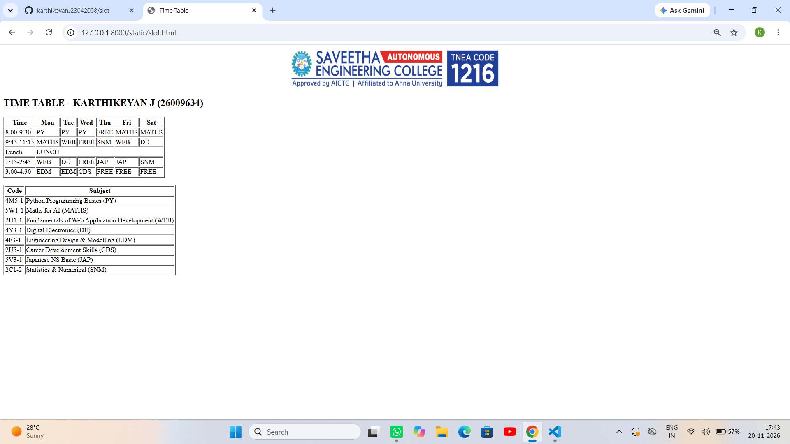

# Ex02 Time Table
## Date:
20/11/2026
## AIM
To write a html webpage page to display your slot timetable.

## ALGORITHM
### STEP 1
Create a Django-admin Interface.

### STEP 2
Create an App inside the Django project.

### STEP 2
Create a static folder uder the created App and insert HTML code.

### STEP 3
Create a simple table using ```<table>``` tag in html with the relevant attributes.

### STEP 4
Add rows using ```<tr>``` tag.

### STEP 5
Add your course schedule using ```<td>``` tag.

### STEP 6
Execute the program using runserver command.

## PROGRAM
```
<html>
<head>
<title>Time Table</title>
</head>
<center>

</center>
<body>

<h2>TIME TABLE - KARTHIKEYAN J (26009634)</h2>

<table border="1">
<tr>
  <th>Time</th><th>Mon</th><th>Tue</th><th>Wed</th><th>Thu</th><th>Fri</th><th>Sat</th>
</tr>
<tr>
  <td>8:00-9:30</td>
  <td>PY</td><td>PY</td><td>PY</td><td>FREE</td><td>MATHS</td><td>MATHS</td>
</tr>
<tr>
  <td>9:45-11:15</td>
  <td>MATHS</td><td>WEB</td><td>FREE</td><td>SNM</td><td>WEB</td><td>DE</td>
</tr>
<tr>
  <td>Lunch</td>
  <td colspan="6">LUNCH</td>
</tr>
<tr>
  <td>1:15-2:45</td>
  <td>WEB</td><td>DE</td><td>FREE</td><td>JAP</td><td>JAP</td><td>SNM</td>
</tr>
<tr>
  <td>3:00-4:30</td>
  <td>EDM</td><td>EDM</td><td>CDS</td><td>FREE</td><td>FREE</td><td>FREE</td>
</tr>
</table>

<br>

<table border="1">
<tr><th>Code</th><th>Subject</th></tr>
<tr><td>4M5-1</td><td>Python Programming Basics (PY)</td></tr>
<tr><td>5W1-1</td><td>Maths for AI (MATHS)</td></tr>
<tr><td>2U1-1</td><td>Fundamentals of Web Application Development (WEB)</td></tr>
<tr><td>4Y3-1</td><td>Digital Electronics (DE)</td></tr>
<tr><td>4F3-1</td><td>Engineering Design &amp; Modelling (EDM)</td></tr>
<tr><td>2U5-1</td><td>Career Development Skills (CDS)</td></tr>
<tr><td>5V3-1</td><td>Japanese NS Basic (JAP)</td></tr>
<tr><td>2C1-2</td><td>Statistics &amp; Numerical (SNM)</td></tr>
</table>

</body>
</html>
```

## OUTPUT


## RESULT
The program for creating slot timetable using basic HTML tags is executed successfully.
